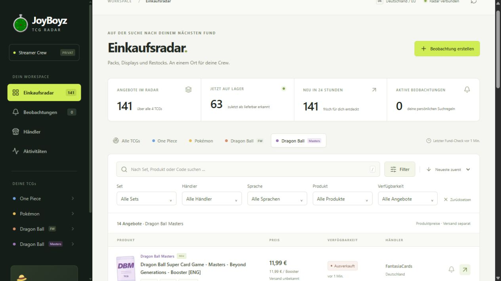

# JoyBoyz TCG Radar

Ein selbst gehostetes Einkaufsradar für eine private Streamer-Crew: **One Piece,
Pokémon, Dragon Ball Super: Fusion World und Dragon Ball Super: Masters**,
primär Deutschland, sekundär EU.

Die Anwendung entdeckt Produkte in öffentlichen Shopkatalogen und überwacht
zusätzlich direkte Produktlinks. Es werden **keine Demo-Angebote** in die Datenbank
geladen. Preise und Verfügbarkeiten stammen aus den jeweiligen Shops.



Das freigegebene Design ergänzt das klassische Radar-Logo und einen kleinen
Strohhut in der Sidebar. Diese Details
sind dekorativ; Navigation, Filter und Angebotsliste behalten ihre Struktur.
Die Sidebar ist auf niedrigen Bildschirmen scrollbar.

## Was funktioniert

- Automatische Entdeckung bei **FantasiaCards (Shopify)** sowie **House of Cards &
  Games, Senpai-Cards, Johto-Cards und BulkParadise TCG (WooCommerce Store API)**;
  alle fünf Quellen live geprüft.
- Getrennte Variantenpreise und Bestände, auch für Booster/Display-Auswahlartikel.
- Separater Worker mit regelmäßigen Abrufen, Shop-Leases, HTTP-Abständen,
  begrenzten Wiederholungen und Backoff bei Fehlern.
- Neue Angebote, Restocks, Vorbestellungen und Preisänderungen samt Verlauf.
- Vue-Dashboard mit Suchfeld, TCG-/Set-/Händler-/Sprach-/Produkttyp-/Bestandsfiltern,
  Sortierung, Seitenwechsel, Detailansicht und direktem Händlerlink.
- Suchregeln mit Preisgrenze, Produktbeobachtung und direkten Produktlinks.
- Mehrfachauswahl für TCGs, Sets, Händler, Sprachen, Produkttypen und Bestand;
  gespeicherte Beobachtungen unterstützen mehrere Werte und lassen sich bearbeiten.
- Acht pausierte Discord-Vorlagen für Displays und Booster der vier TCGs.
- Masters und Fusion World werden getrennt erkannt und gefiltert. Masters-Codes
  wie `B27`, `BT27` und `DBS-B27` werden als `B-27` zusammengeführt.
- Discord und Telegram: gespeicherte Versandwarteschlange, Testalarm,
  Zustellstatus, Deduplizierung über überlappende Regeln und Neustarts hinweg.
- Vergleich konservativ zugeordneter identischer Produkte; keine Vermischung von
  Sprachen, Packgrößen, Einzelboostern und Displays. Unbelegte Packzahlen bleiben
  unbekannt; Versandkosten werden aktuell ausdrücklich als unbekannt ausgewiesen.
- Gemeinsamer Team-Schlüssel, Datenbankmigrationen, Docker Compose und ein
  vorbereitetes GitHub-CI-Workflow für Tests, PostgreSQL und Containerstart.

**Masters-Erweiterung am 07.11.2026:** Viertes TCG, zwei zusätzliche pausierte
Vorlagen und 64 bestandene PostgreSQL-Tests. Echte Masters-Angebote bei zwei
Händlern importiert; Details: [Masters-Abnahme](docs/MASTERS-VERIFICATION.md).

**Vorausgehende Sprint-Abnahme am 07.11.2026:** Docker mit PostgreSQL 16.15 läuft lokal unter
Ubuntu/WSL. 53 Tests gegen eine isolierte PostgreSQL-Datenbank bestanden.
Fünf Shop-Integrationen lieferten zusammen 127 berücksichtigte echte Angebote.
15 Produktstichproben stimmten mit frischen Direktabrufen überein. Zwei erkannte
Zubehör-Fehlzuordnungen bleiben mit Historie gespeichert und sind ausgeblendet.
Ein echter
Discord-Testalarm wurde zugestellt. Ein vollständiges Neuerstellen der Container
erhielt Daten und Zustellstatus ohne erneuten Versand. Einzelheiten:
[Container-Abnahme](docs/CONTAINER-VERIFICATION.md) und
[Sprint- und Qualitätsbericht](docs/SPRINT-QUALITY.md).

## Start mit Docker Compose

Voraussetzungen: Docker Engine/Desktop mit Compose v2; zum Erstellen der `.env`
Python 3.12+ oder eine manuell befüllte Kopie von `.env.example`.

```bash
python3 scripts/setup_env.py
docker compose config --quiet
docker compose up -d --build
```

Unter Windows lautet der erste Befehl gegebenenfalls `python scripts/setup_env.py`.
Das Skript erstellt zufällige Zugangsdaten und überschreibt keine vorhandene
`.env`. Diese Datei bleibt privat und wird nicht in Git eingecheckt.

Dashboard: **http://127.0.0.1:8000**. Den Team-Schlüssel aus `RADAR_API_KEY` in der
lokalen `.env` im Anmeldefeld eingeben. Die ersten Abrufe starten automatisch;
besonders der WooCommerce-Abruf braucht durch Variantenabfragen und die
Abrufabstände ungefähr ein bis wenige Minuten. Es entstehen zunächst keine
Alarme, bis Suchregeln beziehungsweise Produktlinks eingerichtet sind.

```bash
docker compose ps
docker compose logs -f worker
docker compose exec api python -m app.manage scan --shop fantasiacards --force
docker compose down
```

`down` erhält die Datenbank im Volume. `down -v` löscht das Datenbankvolume und
ist ausschließlich für absichtlich zu verwerfende Testinstallationen geeignet.

### Windows mit vorhandener Ubuntu-/WSL-Docker-Laufzeit

Ist Docker in Ubuntu installiert, aber nicht im Windows-PATH, gibt es eine
Projekt-Hilfe. Sie nutzt die vorhandene Ubuntu-Distribution für Docker und
verändert keine Benutzergruppen oder Windows-Features:

```powershell
.\scripts\docker.ps1 compose config --quiet
.\scripts\docker.ps1 compose up -d --build
.\scripts\docker.ps1 compose ps
```

Die Hilfe verwendet für den bestehenden Docker-Daemon den WSL-Administrator.
Wird Docker Desktop später installiert und hat dort noch kein Radar-Projekt,
verwenden Start- und Prüfhelfer weiterhin den vorhandenen Ubuntu-Projektstack.
So bleibt die bisherige Datenbank zugeordnet; der globale Docker-Kontext wird
nicht geändert.
Das Dashboard bleibt an `127.0.0.1:8000` gebunden; der Team-Schlüssel steht in der
privaten `.env`.

Für die lokale Nutzung ohne Docker Desktop kann dieses Vordergrundskript Ubuntu
aktiv halten; das Terminal während der Nutzung offen lassen:

```powershell
.\scripts\start-containers.ps1
# Bei Quelländerungen: .\scripts\start-containers.ps1 -Build
```

WSL kann seine Instanz trotz laufender systemd-Dienste beenden. Das Skript ändert
keine systemweiten WSL-Einstellungen. Auf dem späteren Ubuntu-Server ist dieser
Windows-Helfer nicht erforderlich. [Microsofts WSL-Hinweis](https://learn.microsoft.com/en-us/windows/wsl/systemd)

### Container-Abnahme wiederholen

Nach einem erfolgreichen Image-Build prüfen diese Befehle das tatsächlich
gepackte Backend mit einer separaten, temporären PostgreSQL-Datenbank:

```powershell
# Windows / WSL
.\scripts\test-containers.ps1
# Linux / Ubuntu alternativ: bash scripts/test-containers.sh
```

Der reservierte Compose-Projektname `joyboyz-radar-acceptance` trennt diese Tests
vom Anwendungsbestand. Die Testdatenbank hat keinen veröffentlichten Port und
liegt nur in einem temporären Dateisystem. Nach dem Test werden ausschließlich
die Testcontainer entfernt. Es werden dabei keine echten Alarmkanäle verwendet.

Für die laufende Anwendung gibt es ergänzend:

```bash
python scripts/container_check.py
# Nur auf ausdrücklichen Wunsch einen echten Discord-Testalarm senden:
python scripts/container_check.py --discord
```

Der erste Befehl prüft PostgreSQL, Team-Zugang, Dashboard, Verlauf und erfolgreiche
Shopimporte. `--discord` reiht genau einen Testalarm ein und prüft dessen Status.
Zugangsdaten werden nur im API-Container gelesen und nicht ausgegeben.

## Lokal ohne Docker entwickeln

Python 3.12+, Node 22 und pnpm 11.25.0 verwenden:

```bash
python -m venv .venv
# Windows: .venv\Scripts\activate
# Linux/macOS: source .venv/bin/activate
python -m pip install -r backend/requirements.lock
python -m pip install --no-deps -e backend
pnpm --dir frontend install --frozen-lockfile
pnpm --dir frontend run build
```

**Windows, zwei Terminals:**

```powershell
# Terminal 1: API und bereits gebautes Dashboard
.\scripts\dev.ps1 -Build
# Terminal 2: automatische Überwachung
.\scripts\dev.ps1 -Worker
```

Das Hilfsskript verwendet bewusst eine lokale SQLite-Datenbank, bindet nur an
127.0.0.1 und deaktiviert Alarme. Mit `-EnableNotifications` lassen sich die
in `.env` hinterlegten Alarmkanäle für einen expliziten lokalen Test nutzen.
Die ursprünglichen Prozess-Umgebungsvariablen werden beim Beenden wiederhergestellt.

**Linux/macOS:**

```bash
mkdir -p data
export RADAR_DATABASE_URL=sqlite:///./data/radar.db
export RADAR_ENVIRONMENT=development
export RADAR_API_KEY=
python -m app.manage init
python -m uvicorn app.main:app --host 127.0.0.1 --port 8000
# Zweites Terminal mit denselben Umgebungsvariablen:
python -m app.worker
```

Für Frontend-Live-Reload `pnpm --dir frontend dev` nutzen; Vite leitet `/api` an
Port 8000 weiter. Nach einem Produktionsbuild den API-Prozess neu starten, wenn
die Anwendung vorher ohne vorhandenes `frontend/dist` gestartet war.

## Discord und Telegram einrichten

In `.env` den gewünschten Kanal setzen und `RADAR_NOTIFICATIONS_ENABLED=true`
aktivieren. Danach `docker compose up -d` ausführen, damit API und Worker die
geänderte Umgebung erhalten.

- **Discord:** Webhook eines privaten Crew-Kanals erstellen und seine URL in
  `RADAR_DISCORD_WEBHOOK_URL` eintragen. Nachrichten enthalten keine automatischen
  Rollen-/Everyone-Erwähnungen.
- **Telegram:** Bot erstellen, zum gewünschten Chat hinzufügen, gegebenenfalls
  einmal `/start` senden. `RADAR_TELEGRAM_BOT_TOKEN` und
  `RADAR_TELEGRAM_CHAT_ID` setzen. Telegram verwendet ausgehend `sendMessage` der
  offiziellen Bot-API; ein öffentlich erreichbarer eingehender Webhook ist unnötig.
- Dashboard → **Beobachtungen → Alarmkanäle testen**. Der Worker stellt den
  Test zu; unter **Aktivitäten** stehen Erfolg oder Fehler.

Regeln gelten für kommende neue Angebote, Restocks oder Preissenkungen. Bereits
beobachtete Angebote werden beim Anlegen einer Regel nicht rückwirkend gemeldet.
Preisgrenzen beziehen sich auf den Produktpreis in EUR. Vorbestellungen sind
standardmäßig ausgenommen. Eine Nachricht pro Ereignis und Kanal wird auch dann
erzeugt, wenn mehrere Regeln passen. Bei einer unklaren Zustellung, etwa nach
verlorener HTTP-Antwort, gibt es **keine automatische Wiederholung**, um doppelte
Nachrichten zu vermeiden. Der Status lautet dann `uncertain`.

## Umgebungsvariablen

| Variable | Bedeutung / Vorgabe |
| --- | --- |
| `POSTGRES_PASSWORD` | PostgreSQL-Passwort für Compose; vom Setup generiert |
| `RADAR_API_KEY` | Team-Schlüssel; in Produktion mindestens 32 Zeichen |
| `RADAR_DATABASE_URL` | SQLAlchemy-Verbindung; wird in Compose intern gesetzt |
| `RADAR_ENVIRONMENT` | `production` in Compose, `development` für lokale Entwicklung |
| `RADAR_NOTIFICATIONS_ENABLED` | Versand aktivieren; standardmäßig `false` |
| `RADAR_DISCORD_WEBHOOK_URL` | Optionaler Discord-Webhook |
| `RADAR_TELEGRAM_BOT_TOKEN` / `RADAR_TELEGRAM_CHAT_ID` | Optionale Telegram-Zugangsdaten |
| `RADAR_USER_AGENT` | Kennung für die Shopabrufe; optional Betreiberkontakt ergänzen |
| `RADAR_REQUEST_DELAY_SECONDS` | Mindestabstand pro Shop-Anfrage; Vorgabe 2 Sekunden |
| `RADAR_STALE_AFTER_MINUTES` | Alte Beobachtungen als unbekannt anzeigen; Vorgabe 30 |
| `RADAR_HISTORY_RETENTION_DAYS` | Aufbewahrung der Preis-/Bestandsbeobachtungen; Vorgabe 90 Tage |
| `RADAR_SHOPS_FILE` | Pfad der Shop-Konfiguration; Vorgabe `config/shops.json` |
| `RADAR_BIND_ADDRESS` / `RADAR_PORT` | Compose-Bindung; Vorgabe `127.0.0.1:8000` |
| `RADAR_DOMAIN` | Nur für die optionale Ubuntu-/Caddy-Konfiguration |

Schlüssel und Kanal-Zugangsdaten werden nicht über die API ausgegeben. Das
Dashboard hält den eingegebenen Team-Schlüssel nur für die Browser-Sitzung.

## Weitere Shops ergänzen

In [config/shops.json](config/shops.json) einen Händler mit eindeutiger `slug`,
`base_url`, `country`, `adapter`, `interval_seconds` und `config` aufnehmen.
Vor dem Einsatz Endpunkte und Zugangsbedingungen prüfen. Anschließend:

```bash
docker compose run --rm migrate
docker compose restart worker
```

Vorhandene Adapter:

- `shopify`: `page_size`, `max_pages`, `currency`, optional `collections`.
- `woocommerce`: `page_size`, `max_pages`, `searches` für ausgewählte Suchbegriffe.

Für andere Shops eine Klasse mit `discover()` und `fetch_url()` unter
`backend/app/adapters/` implementieren und in `ADAPTERS` registrieren. Sie liefert
`SourceOffer`-Objekte; Identifikation, Historie, Regeln und Benachrichtigungen
bleiben unverändert. Basisklasse und Tests zeigen das erwartete Format.

Die konfigurierten Abrufe sind absichtlich begrenzt. Sie decken nicht den gesamten
Markt und nicht jeden älteren Shopartikel ab. Direkte Produktlinks werden
zusätzlich abgefragt. Ein fehlender Artikel im Katalogauszug gilt nie automatisch
als ausverkauft. Verbindungsfehler und veraltete Prüfungen ergeben `unbekannt`.

## Tests und Build

```bash
python -m pytest backend/tests --cov=app
pnpm --dir frontend run build
python -m alembic -c backend/alembic.ini check
```

Die Tests verwenden klar gekennzeichnete synthetische Fixtures und simulierte
HTTP-Antworten. Sie sind keine Live-Shop-Nachweise. Optional führt
`RADAR_TEST_DATABASE_URL` die Datenbanktests gegen eine separate
PostgreSQL-Testdatenbank mit pro Test isoliertem Schema aus. Ausschließlich einen
dafür vorgesehenen Testzugang verwenden.

Die GitHub-Workflow-Datei prüft zusätzlich PostgreSQL-Migrationen und den
Compose-Start. Der erste GitHub-Lauf bestand den Frontend-/Container-Job;
im Backend-Job fehlte der Elternordner des temporären Testpfads. Der korrigierte
Pfad wurde lokal in einem frischen Linux-Checkout mit PostgreSQL geprüft
(64 Tests bestanden); ein neuer GitHub-Lauf steht noch aus.
Die gebaute Linux-Anwendung lässt sich auch lokal gegen eine eigene, temporäre
PostgreSQL-Testdatenbank prüfen, ohne die Anwendungsdatenbank zu verändern:

```powershell
.\scripts\test-containers.ps1
```

Unter Linux: `bash scripts/test-containers.sh`. Beide Varianten verwenden das
separate Compose-Projekt `joyboyz-radar-acceptance` und räumen es anschließend auf.
Die laufende Installation prüft `python scripts/container_check.py` lesend.
Für erneute echte Verifikation nach einem Import:

```bash
python scripts/verify_live.py
```

## Ubuntu und Produktionsfreigabe

Die Dateien sind für einen späteren Ubuntu-Server vorbereitet. **Es wurde nichts
produktiv deployed oder öffentlich veröffentlicht.** Vorgehen und Backup:
[Deployment-Anleitung](docs/DEPLOYMENT.md).

## Bewusste Grenzen und nächste Schritte

- Fünf Händler, begrenzte Katalogfenster; weitere gute DE/EU-Quellen liefern den
  größten zusätzlichen Nutzen.
- Kein vollständiger Sealed-Katalog. Fehlende Packzahlen/Produktmerkmale werden
  nicht geraten. Im ersten Live-Ausschnitt lagen noch keine sicher zugeordneten
  Händlerpaare für dasselbe Produkt vor; der Vergleich ist mit getrennten
  Händlerdaten automatisiert getestet.
- Keine exakten Lagermengen, Warenkorb-Versandberechnung, Käufe oder Reservierungen.
- Gemeinsamer Team-Zugang; noch keine einzelnen Nutzerkonten oder Rollen.
- B2B-Konten, Lieferantenimporte und Bestell-/Stream-Bedarfsplanung sind spätere
  Erweiterungen.
- Ein Worker ist die vorgesehene Betriebsgröße. PostgreSQL verwendet pro Shop
  eine verbindungsgebundene Sperre, die auch nach einem Prozessabbruch automatisch
  freigegeben wird. Die SQLite-Entwicklungsvariante behält als einfacheren
  Rückfall eine zeitlich begrenzte Lease.

Die Architekturentscheidung und verwendeten Open-Source-Komponenten stehen in
[docs/ARCHITECTURE.md](docs/ARCHITECTURE.md).
