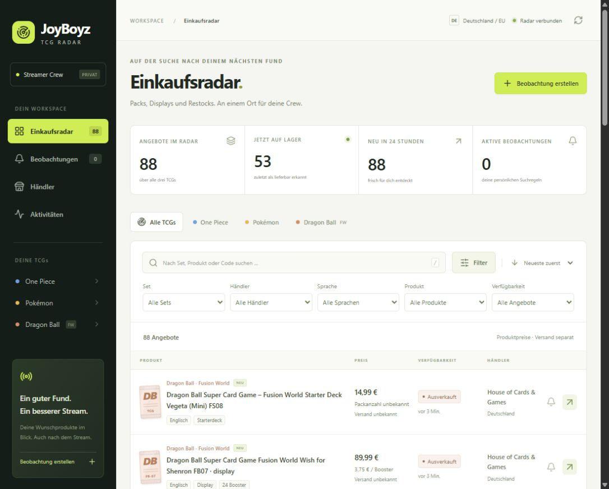

# Lokale Container-Abnahme

Dies ist die erste Container-Abnahme. Der anschließende Stand mit fünf Händlern,
127 berücksichtigten Angeboten, Mehrfachfiltern und 53 Tests steht im
[Sprint- und Qualitätsbericht](SPRINT-QUALITY.md).

Tatsächlich ausgeführt am **07.11.2026, Europe/Berlin**. Dies ist eine lokale
Installation auf dem Entwicklungsrechner, keine Veröffentlichung auf einem Server.

## Umgebung und Ergebnis

| Prüfung | Ergebnis |
| --- | --- |
| Container-Laufzeit | Docker Engine 29.8.2, Compose 5.6.0, Ubuntu 24.04.4 unter WSL2 |
| Image | Vollständiger mehrstufiger Build mit Frontend und Python-Anwendung erfolgreich |
| Datenbank | PostgreSQL 16.15, persistentes benanntes Docker-Volume |
| Migrationen | Leere Datenbank erfolgreich aufgebaut; Alembic meldet keine Schemaabweichungen |
| Automatisierte Tests | 44 bestanden gegen isoliertes PostgreSQL im gebauten Linux-Image |
| API und Dashboard | Healthcheck erfolgreich, Dashboard ausgeliefert, Datenzugriff ohne Team-Schlüssel abgewiesen |
| Browser | Anmeldung, 88 Angebote, zwei erfolgreiche Händler und Alarmstatus „Zugestellt“ geprüft |
| Erreichbarkeit | API ausschließlich über 127.0.0.1:8000; kein veröffentlichter Datenbankport |

Die automatisierten Tests verwenden synthetische Fixtures und simulierte
Shopantworten. Die folgenden Abrufe und der Discord-Versand wurden separat echt
ausgeführt. Die Testdatenbank lag im Arbeitsspeicher eines eigenen Compose-Projekts;
Testcontainer und Testnetzwerk wurden anschließend entfernt.

## Echte Katalogabrufe

| Händler | Letzter erfolgreicher Check (Berlin) | Importierte Angebote |
| --- | --- | --- |
| FantasiaCards | 07.11.2026, 01:22:51 | 46 |
| House of Cards & Games | 07.11.2026, 01:22:39 | 42 |

Der PostgreSQL-Bestand enthält **88 echte Angebote** und 88 Entdeckungsereignisse.
Davon wurden 53 als lieferbar, 32 als ausverkauft und drei als Vorbestellung
beobachtet. Keine Demo-Angebote wurden geladen. Die begrenzten Katalogfenster
stellen keine vollständige Marktabdeckung dar; Endpreis und Bestand sind beim
Händler zu bestätigen.

## Discord und Neustart

Nach ausdrücklicher Freigabe des Nutzers wurde **genau ein** Testalarm über den
lokal hinterlegten Webhook gesendet. Die Warteschlange bestätigt:

- Kanal: Discord, Benachrichtigung 1
- Status: `sent`, ein Versandversuch
- Zustellung: **07.11.2026, 01:15:47 Europe/Berlin**

Danach wurden alle Container des Anwendungsprojekts mit `compose down` entfernt
und mit `compose up -d --no-build` neu erstellt. Das Datenbank-Volume blieb
erhalten. Die anschließende lesende Prüfung bestätigte wieder 88 Angebote,
88 Ereignisse und genau eine zugestellte Benachrichtigung mit unverändertem
Versandzeitpunkt und einem Versuch. Es wurde kein weiterer Testalarm gesendet.

Bei der Abnahme fiel eine verwaiste Abrufsperre nach einem Worker-Abbruch auf.
Die PostgreSQL-Ausführung verwendet jetzt eine separate Verbindung mit einer
transaktionsgebundenen Advisory-Sperre pro Händler. Ein Verbindungsabbruch gibt
sie automatisch frei. Zwei PostgreSQL-Regressionstests prüfen die Wiederaufnahme
nach verwaister Zeitmarkierung sowie den Ausschluss gleichzeitig aktiver Abrufe.
Der zuvor blockierte Händler wurde danach automatisch erfolgreich importiert.

## Wiederholen und lokal starten

Im Projektverzeichnis unter PowerShell:

```powershell
.\scripts\start-containers.ps1
```

Das Dashboard liegt unter <http://127.0.0.1:8000>. Den Team-Schlüssel aus
`RADAR_API_KEY` in der privaten `.env` verwenden. Ohne natives Windows-Docker
verwendet das Hilfsskript die bereits installierte Ubuntu-Docker-Engine und hält
WSL mit einem Vordergrundprozess aktiv; dieses Terminal während der Nutzung
offen lassen. Es wurden keine globalen WSL-Einstellungen oder Gruppen geändert.

```powershell
.venv\Scripts\python.exe scripts/container_check.py
.\scripts\test-containers.ps1
.\scripts\docker.ps1 compose exec -T api python -m alembic -c backend/alembic.ini check
```

`container_check.py` liest nur den laufenden Zustand. Der optionale Schalter
`--discord` sendet dagegen einen neuen echten Testalarm und ist für die normale
Abnahme nach einem Neustart nicht nötig. Geheimnisse gehören ausschließlich in
die private `.env`; sie wurden nicht in diesen Bericht aufgenommen.

Produktalarme entstehen erst nach Einrichtung passender Beobachtungen. Zum
Abnahmezeitpunkt existieren noch keine Suchregeln. Telegram-Livezustellung,
öffentlicher HTTPS-Betrieb, Backup-Wiederherstellung und GitHub-CI wurden in
dieser lokalen Abnahme nicht ausgeführt.


