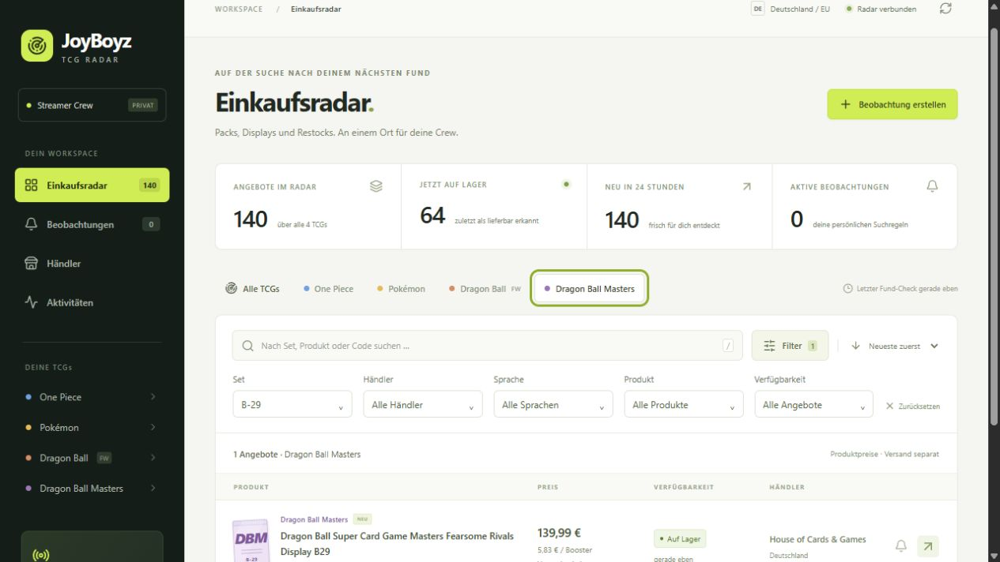

# Dragon Ball Super Masters

Lokal implementiert und geprüft am **07.11.2026, Europe/Berlin**.

Masters ist das vierte TCG mit eigenem Schlüssel `dragon-ball-masters`, eigenem
Filter, violetter Kennzeichnung und zwei pausierten Discord-Regelvorlagen.
Fusion World bleibt unter `dragon-ball-fusion-world` getrennt. Bestehende
Suchregeln und deren Aktivierungszustand wurden nicht geändert.

## Erkennung und Sets

Die Erkennung berücksichtigt ausdrücklich genannte Masters-Produkte, Zenkai,
Unison Warrior sowie Dragon-Ball-Produkte mit B-/BT-Setcodes. Ein eindeutiger
Produkttitel hat Vorrang vor gemischten Shopkategorien. Widersprüchliche
Produktlinien im Titel werden nicht geraten.

`B27`, `B-27`, `BT27` und `DBS-B27` werden als `B-27` gespeichert und in Suche
und Regeln gleich behandelt. Bandai verwendet beispielsweise beim
[Produkt Beyond Generations die Bezeichnung DBS-B24](https://www.dbs-cardgame.com/us-en/product/dbs-b24.php)
und in der [zugehörigen Kartenliste BT24-Kartennummern](https://www.dbs-cardgame.com/asia/cardlist/?category=428024&search=true).
Nummerierte Einzelkarten bleiben ausgeschlossen; eine Setnummer wird nicht als
Boosteranzahl verwendet. Sprachen, Packzahlen, Sondereditionen und Produktlinien
bleiben getrennte Vergleichsmerkmale.

Die Set-Auswahl enthält erkannte Codes importierter Angebote, keinen vollständigen
Masters-Katalog. Ein Masters-Angebot ohne belegten Setcode kann erscheinen,
bleibt aber ohne Setzuordnung. Andere Masters-Produktserien ohne B-/BT-Code werden
bei eindeutigem Masters-Titel als Produkte erkannt, erhalten derzeit aber keine
automatische Erweiterungszuordnung über ihren andersartigen Code.

## Echte Quellen

Die vier bestehenden WooCommerce-Konfigurationen suchen zusätzlich nach
`Masters` und `Dragon Ball`. Die begrenzte Seitengröße und Abrufabstände bleiben
erhalten. Shopify entdeckt weiterhin über das bestehende Katalogfenster.

| Händler | Importierte Masters-Angebote |
| --- | --- |
| House of Cards & Games | 11 |
| Johto-Cards | 2 |

Zum Prüfzeitpunkt **13 Masters-Angebote**, davon eines als lieferbar und zwölf
als ausverkauft beobachtet. Erkannte Setcodes: **B-21, B-24, B-27, B-28, B-29,
B-30 und B-31**. Der Gesamtbestand des Radars steigt damit auf 140 berücksichtigte
Angebote; die zwei früher ausgeschlossenen Zubehörimporte bleiben ausgeblendet.

Am **07.11.2026 um 02:47 Uhr Berlin** wurden außerdem zwei direkte
Produktabrufe ausgeführt, je einer pro Masters-Händler. Preis und beobachteter
Bestand stimmten mit dem Import überein:

- House of Cards & Games: Beyond Generations Collector’s Display, 449,99 EUR,
  ausverkauft; der Titel enthält keinen Setcode, daher keine geratene Zuordnung.
- Johto-Cards: History of Z BT27 Booster, 11,95 EUR, ausverkauft, Set B-27.

Das sind zeitgebundene Quellbeobachtungen, keine Checkout-Zusicherung. Lokaler
Rohbeleg: ignorierte Datei `data/masters-verification.json`.

## Ausgeführte Prüfung

- **64 Tests bestanden** im gebauten Linux-Image gegen isoliertes PostgreSQL;
  Testcontainer und Testnetzwerk entfernt.
- Frontend-TypeScript-Prüfung und Produktionsbuild erfolgreich.
- Tests für Code-Aliasse, Einzelkarten-/Zubehör-Ausschluss, Packzahlen,
  Konflikte zwischen Produktlinien und getrennte Masters-Regeln.
- API mit vier TCGs, Masters-Angeboten, B-27-Setfilter und B-/BT-Suche geprüft.
- Browser: eigener Masters-Filter mit 13 Treffern; Set B-29 zeigt das getrennte
  englische Display für 139,99 EUR mit beobachtetem Lagerbestand.
- Zwei Masters-Vorlagen in der Oberfläche als **pausiert** bestätigt.
- Kein weiterer Discord-Testalarm und keine aktive breit gefasste Regel angelegt.

Für eine weitere Installation Anwendung wie gewohnt neu bauen und starten;
der vorhandene Seed ergänzt das TCG ohne Schemaänderung. Anschließend können
die pausierten Vorlagen ausdrücklich ergänzt werden:

```bash
docker compose up -d --build
docker compose exec -T api python -m app.manage templates
```

Die lesende Masters-Abnahme lässt sich im anfänglichen Zustand mit pausierten
Vorlagen wiederholen:

```powershell
.venv\Scripts\python.exe scripts/container_check.py --masters
```


