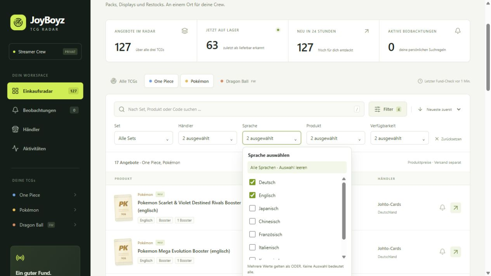

# Mehrfachfilter, Vorlagen und Händlererweiterung

Lokale Abnahme vom **07.11.2026, Europe/Berlin**. Kein Produktionsdeploy.

## Fertiger Umfang

- Mehrfachauswahl im Einkaufsradar: TCGs, Sets, Händler, Sprachen, Produkttypen
  und Verfügbarkeit. Mehrere Werte einer Gruppe gelten als ODER, Gruppen
  untereinander als UND. Suche und Sortierung bleiben einwertig. „Alle“ leert
  die betreffende Gruppe; „Zurücksetzen“ entfernt alle Filter.
- Native Checkboxen in aufklappbaren Menüs, Suchfeld bei langen Setlisten,
  Schließen per Escape oder Klick außerhalb. TCG-Schaltflächen lassen sich
  kombinieren. Seitenwechsel und Trefferzahl werden serverseitig gefiltert.
- Neue Beobachtungen übernehmen die Mehrfachauswahl. Gespeicherte Regeln sind
  inklusive Preisgrenze bearbeitbar; mehrere Set-Codes einschließlich noch nicht
  importierter Sets lassen sich hinterlegen.
- Sechs **pausierte** Discord-Vorlagen: je Booster und Displays für One Piece,
  Pokémon und Dragon Ball Super Fusion World. Keine erfundenen Zielpreise oder
  Sets; Sprachen und Händler zunächst uneingeschränkt. Vor Aktivierung passend
  bearbeiten. Die Vorlagen lösen bis dahin keine Produktalarme aus.

Zum expliziten Anlegen in einer weiteren Installation:

```bash
docker compose exec -T api python -m app.manage templates
```

Die Anlage prüft vorhandene Vorlagennamen und überschreibt keine Einstellungen.
Umbenannte Vorlagen werden bei einem erneuten Aufruf als eigene Regeln behandelt.

## Echte Händlerabdeckung

| Händler | Abrufweg | Berücksichtigte Angebote |
| --- | --- | --- |
| [FantasiaCards](https://fantasiacards.de) | Shopify, drei Seiten à 50 Katalogartikel | 46 |
| [House of Cards & Games](https://house-of-cards-and-games.de) | Woo Store API, drei Suchbegriffe und Varianten | 42 |
| [Senpai-Cards](https://senpai-cards.de/shop/) | Woo Store API, drei Suchbegriffe | 20 |
| [Johto-Cards](https://johto-cards.de/shop/) | Woo Store API, drei Suchbegriffe | 12 |
| [BulkParadise TCG](https://bulkparadise-tcg.de/pokemon-karten-kaufen/) | Woo Store API, drei Suchbegriffe | 7 |

Die drei neuen Quellen werden alle 20 Minuten geprüft, mit mindestens zwei
Sekunden Abstand zwischen HTTP-Anfragen und vorheriger robots.txt-Prüfung.
Suchbegriffe sind Pokémon, One Piece und Fusion World; nicht jeder Händler
liefert dabei Treffer für alle drei Spiele. Direkte Links unterstützen auch
englische WooCommerce-Permalinks mit `/product/`.

Nach der Bereinigung: **127 berücksichtigte Angebote**, davon 63 als lieferbar,
61 ausverkauft und drei als Vorbestellung beobachtet. Zwei zusätzliche falsche
Zubehörtreffer bleiben für die Historie gespeichert, erscheinen aber nicht in
Radar, Vergleich, Aktivitätsliste oder Alarm-Matching. Die Aufbewahrung erklärt
die insgesamt 129 gespeicherten Entdeckungsereignisse.

Die Katalogfenster sind begrenzt und keine vollständige Marktübersicht. Der
Senpai-Ausschnitt ist derzeit ausverkauft; er ergänzt die Restock-Beobachtung,
liefert momentan aber keine kaufbaren Treffer. Die Aufnahme ist eine technische
Quellenprüfung und keine Händlerempfehlung oder Zusicherung zur Lieferfähigkeit.

Gem Cards, Takara Toys und BreakTheCase wurden ebenfalls geprüft. Die Abrufe
antworteten mit HTTP 429 und einer Wartezeit von 60 Sekunden. Sie wurden nicht
aktiviert; ein späterer zulässiger Integrationsversuch bleibt möglich.

## Qualität und gefundene Fehler

Der lesende Audit vom **07.11.2026, 02:00 Uhr Berlin** verglich 15 gespeicherte
Angebote mit frischen Direktproduktabrufen, drei je Händler. Die Auswahl variiert
TCG, Produkttyp und Sprache. **15 Übereinstimmungen, keine Abweichung und kein
fehlgeschlagener Direktabruf** bei Preis, Währung, beobachtetem Bestand, Titel,
Sprache, Verpackungstyp und belegter Boosteranzahl.

Das ist ein Konsistenztest zweier Abrufwege mit demselben Adapter und derselben
Produktzuordnung. Er ist **keine unabhängige Bestätigung eines Checkout-Bestands**
und kann gemeinsam verwendete Parserfehler nicht ausschließen. Die zusätzliche
Sichtprüfung und Detailanalyse fand deshalb zwei wichtige Fehlerklassen:

1. **Setnummer als Packzahl:** „Pokémon 151“ durfte nicht als 151 Booster gelesen
   werden. Außerdem sind innere Bundles oder Tins in einem Display kein Beleg
   für die gesamte Boosterzahl. Ohne ausdrückliche Gesamtmenge bleibt diese
   unbekannt. Beispiel: Die [151-Bundle-Display-Seite von Johto-Cards](https://johto-cards.de/produkt/scarlet-violet-pokemon-151-booster-bundle-display-englisch/)
   nennt zehn Bundles, keine 151 Booster.
2. **Zubehör als Sealed-Produkt:** Zwei Acryl-Schutzhüllen enthielten „Booster Box“
   beziehungsweise „ETB“ im Titel. Acrylhüllen werden jetzt ausdrücklich
   ausgeschlossen. Bei erneut abgelehnten früheren Importen setzt der Scanner
   ein Ausschlussmerkmal; die Historie bleibt erhalten. Eine spätere valide
   Produktkorrektur kann das Angebot wieder zulassen.

Rohbelege liegen lokal in den ignorierten Verzeichnissen `data/sprint-probes/`
und `data/sprint-quality.json`. Erneute lesende Stichprobe:

```powershell
.venv\Scripts\python.exe scripts/container_check.py --quality
```

## Ausgeführte Abnahme

- **53 Tests bestanden** im gebauten Linux-Image gegen eigenes temporäres
  PostgreSQL; Testprojekt und Netzwerk anschließend entfernt.
- Frontend mit TypeScript-Prüfung und Produktionsbuild erfolgreich.
- Beide additiven Migrationen auf der bestehenden PostgreSQL-Datenbank
  angewendet; Migrationen erhalten Angebote, Alarme und Regeln.
- Servertests prüfen ODER/UND-Verknüpfung, kombinierte Sets, Stale-Status,
  Pagination, Grenzen der Auswahllisten, Legacy-Einzelparameter, Regelbearbeitung,
  Deduplizierung, Vorlagen und Zubehör-Ausschluss samt erhaltener Historie.
- Browser: zwei TCGs, zwei Händler, zwei Sprachen, Booster und Display sowie
  Lagerbestand und Vorbestellungen kombiniert; **17 passende Angebote**.
- Browser: pausierte Vorlage mit zwei Sprachen und 123,45 EUR gespeichert und
  erneut geöffnet; danach auf alle Sprachen und ohne Preisgrenze zurückgesetzt.
- Mobile Prüfung bei 390 × 844, Checkbox-Menüs und Escape geprüft; temporäre
  Bildschirmgrößenänderung anschließend zurückgesetzt.
- Der bestehende Discord-Testalarm bleibt der einzige Versand. Keine neuen
  Testalarme oder aktiven breit gefassten Regeln angelegt.

Ein mehrtägiger Praxistest mit echten Zielsets und Preisgrenzen steht noch aus.
Erst dabei lassen sich Reaktionszeit auf reale Restocks und die praktische
Relevanz der Discord-Treffer beurteilen.


